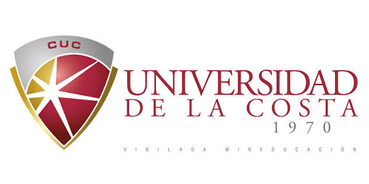

# Hola, soy Jayri 🌸

*"Con curiosidad, helado y muchas ganas de aprender."* 🍦

---

## Sobre mí ✨

- 🔭 Actualmente trabajo en el proyecto **StockLite (SAAS BPDS CUC1)**
- 🌱 Estoy aprendiendo Git, GitHub y desarrollo de software
- 💡 Me motiva crear cosas útiles con código
- 🍦 Me encantan el helado y las buenas ideas

<h2>Carrera 🎓</h2>

<table>
  <tr>
    <td>
      
    </td>
    <td>
      
       
      <b>Técnico en Desarrollo de Software</b>
       
      📧 <a href="mailto:jbarretop@cuc.edu.co">jbarretop@cuc.edu.co</a>
    </td>
  </tr>
</table>
## Mis hobbies 🌷

- 🍦 Probar sabores nuevos de helado
- 🎧 Escuchar música mientras estudio
- 📸 Tomar fotos
- 🌱 Aprender cosas nuevas cada día

## Mis proyectos 🚀

- **StockLite / SAAS BPDS CUC1:** aplicación web para el control de stock y reposición en pequeños negocios (proyecto del curso, trabajo en equipo).
- **Mi perfil de GitHub:** mi espacio para practicar Git y Markdown.

## Mi Tech Stack 🛠️

## Contacto 📫

- Correo institucional: jbarretop@cuc.edu.co

<h2>Carrera 🎓</h2>

<table>
  <tr>
    <td>
      
    </td>
    <td>
      
       
      <b>Técnico en Desarrollo de Software</b>
       
      📧 <a href="mailto:jbarretop@cuc.edu.co">jbarretop@cuc.edu.co</a>
    </td>
  </tr>
</table>
